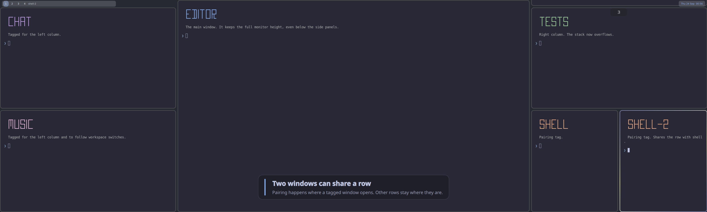

# hyprtrizone

[](https://github.com/nyrda/hyprtrizone/actions/workflows/ci.yml)

A Hyprland layout for ultrawide monitors. The main window sits in the middle
of the screen, where you look most. A scrolling stack on each side holds
everything else. Two windows can share a row in a side stack, and window tags
decide where a window goes.

[](docs/demo.mp4)

**[▶ Watch the feature tour](docs/demo.mp4)** (3600×1080, 80 seconds).
It was recorded by `./dev.sh vm-demo-video` in a NixOS VM.

This is a personal plugin. It is built and tested against **Hyprland 0.56.2**
with a Lua configuration. The Nix flake pins the compositor and the plugin
together. Other Hyprland releases have their own `hyprland-<version>` branches.

## Features

- **Three columns.** The center takes half the width by default, and each side
  a quarter. The center can hold several windows, stacked vertically.
- **Scrolling side stacks.** Rows keep a readable height and scroll instead of
  shrinking. Badges count the windows above and below the visible part. Each
  workspace keeps its own scroll position.
- **Pairing.** Two windows can share a side row. A pair forms where a window
  opens; other rows stay where they are.
- **Tag-based placement.** Hyprland window rules tag windows for a column, for
  pairing, or to follow you between workspaces.
- **Drag and drop.** Drop a window onto another to pair with it or exchange
  places. Keyboard moves travel across columns and rows.
- **Room for side panels.** Space can be reserved above either side stack only,
  so a panel fits there while the center keeps the full monitor height.
- **Runtime commands.** Scroll, move windows between zones, and toggle
  scrolling or pairing from binds or `hyprctl`.

## Try it in a VM

```sh
git clone https://github.com/nyrda/hyprtrizone.git
cd hyprtrizone
./dev.sh vm-demo
```

Nix boots a disposable NixOS VM with Hyprland, a set of example windows, and
the [Quickshell panels](examples/quickshell/README.md). It needs KVM and a
graphical session, and its disk is discarded on exit.


The demo VM binds these keys:

| Keys | Action |
| --- | --- |
| `Super+Return` | Open a terminal |
| `Super+Q` | Close the focused window |
| `Super+Arrows` | Move focus |
| `Super+Shift+Arrows` | Move the window between columns or rows |
| `Super+Left drag` | Drag a window; drop it onto another to pair or exchange |
| `Super+Right drag` | Resize |
| `Super+Wheel` | Scroll the focused side stack, or the right one from the center |
| `Super+1/2/3` | Switch workspace |
| `Super+Shift+F7` | Reopen the demo windows |
| `Super+Shift+F8/F9` | Toggle pairing on the left/right side |
| `Super+Shift+F10` | Toggle scrolling |
| `Super+M` | Exit Hyprland |

The layout settings come from [`examples/hyprtrizone-demo.lua`](examples/hyprtrizone-demo.lua),
which also runs in a normal session. The VM adds the general Hyprland binds;
the example file only binds the wheel and the F-keys.

## Install

The plugin must be built against the exact Hyprland build that loads it.
[Installation](docs/installation.md) covers NixOS, a manual build, and hyprpm.
[Omarchy](docs/omarchy.md) has its own guide.
On NixOS, the module installs the matching Hyprland and a Lua loader:

```nix
# flake.nix
inputs.hyprtrizone.url = "github:nyrda/hyprtrizone";
```

```nix
# A NixOS module, with inputs passed through specialArgs.
{ inputs, ... }: {
  imports = [ inputs.hyprtrizone.nixosModules.default ];
  programs.hyprtrizone.enable = true;
}
```

```lua
-- hyprland.lua. Load the plugin before configuring it.
dofile("/etc/xdg/hypr/hyprtrizone_plugin.lua")

hl.config({
    general = { layout = "hyprtrizone" },
    plugin = { hyprtrizone = {
        master_factor = 0.5,
        side_bias = "right",
        side_visible_windows = 3,
    } },
})

hl.bind("SUPER + mouse_up", hl.dsp.layout("scroll up"))
hl.bind("SUPER + mouse_down", hl.dsp.layout("scroll down"))
hl.bind("SUPER + SPACE", hl.dsp.layout("swapwithmaster"))
```

## Documentation

| Document | Contents |
| --- | --- |
| [Installation](docs/installation.md) | NixOS module, Nix packages, manual build, hyprpm, troubleshooting |
| [Omarchy](docs/omarchy.md) | Installing on Omarchy 4, keybindings, the bar, hyprpm |
| [Configuration](docs/configuration.md) | Every option with its default, and every runtime command |
| [Window behavior](docs/behavior.md) | Placement, pairing, scrolling, drag and drop, resizing, workspaces |
| [Quickshell example](examples/quickshell/README.md) | Panels above the side stacks |
| [Development](docs/development.md) | Builds, live reloading, VM tests, the demo video, source layout |

## Development

```sh
./dev.sh build                # Clean build of hyprtrizoneLayout.so
./dev.sh vm-test              # Headless layout integration test
./dev.sh vm-demo-screenshot   # Demo session test; updates docs/demo.png
./dev.sh vm-demo-video        # Records the feature tour; updates docs/demo.mp4
```

CI builds the plugin and runs both VM tests on the pinned package set.

## License

[MIT](LICENSE)
