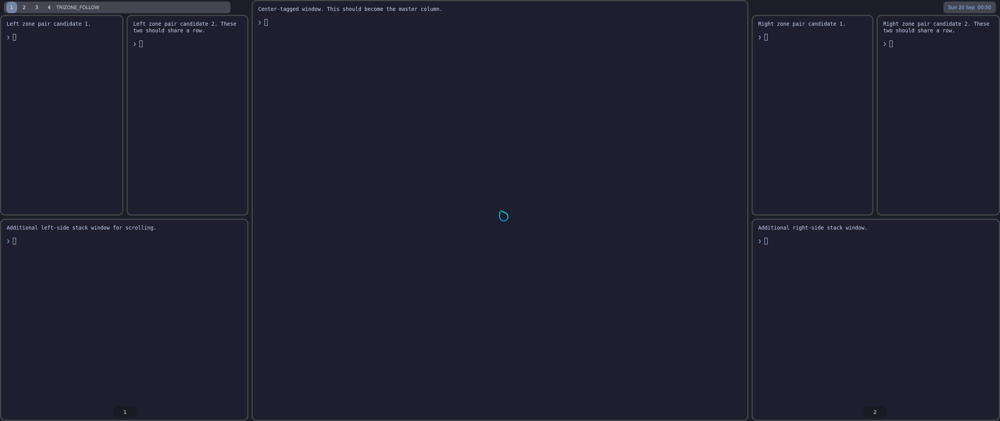

# hyprtrizone

[](https://github.com/nyrda/hyprtrizone/actions/workflows/ci.yml)

A Hyprland layout plugin for ultrawide monitors. The main window sits in the
middle of the screen, where you look most, and a scrolling stack on each side
holds everything else. Two windows can share a row in a side stack, and window
tags decide which column a window opens in.

https://github.com/user-attachments/assets/9628c5b4-0ba5-4364-8d96-cf6a1bbaf8cb

Hyprland's `master` layout can center the main window too, but it splits a
single stack across both sides: windows jump between left and right as others
open and close, and every window shrinks to fit. Here each side is a stack of
its own. Windows stay on their side, keep a readable row height, and scroll.
Unlike a scrolling layout, the center never moves.

## Features

- **Three columns.** The center takes half the width by default, and each side
  a quarter. The center can hold several windows, stacked vertically.
- **Scrolling side stacks.** Rows keep a readable height and scroll instead of
  shrinking. Badges show how many windows are scrolled out of view. Each
  workspace keeps its own scroll position.
- **Pairing.** Two windows can share a side row. A pair forms where a window
  opens.
- **Tag-based placement.** Hyprland window rules tag windows for a column or
  for pairing.
- **Windows that follow you.** A tiled window tagged to follow, such as a music
  player or a chat, moves along when you switch workspaces on its monitor.
  Because each side is a stack of its own, it keeps its column and goes to the
  top of it, and the other windows stay on their sides.
- **Drag and drop.** Drag a window onto another to reorder, pair, or exchange
  places. Keyboard moves travel across columns and rows.
- **Wheel scrolling.** With a modifier held, the mouse wheel scrolls the side
  stack under the pointer.
- **Room for side panels.** Space can be reserved above either side stack only,
  so a panel such as the [Quickshell example](examples/quickshell/README.md)
  fits there while the center keeps the full monitor height.

## Compatibility

- hyprtrizone is built and tested against **Hyprland 0.56.2** and supports
  only Hyprland's Lua configuration, not a classic `hyprland.conf`.
- A Hyprland plugin only loads into the exact Hyprland build it was compiled
  against, so it has to be rebuilt after every Hyprland update. The NixOS
  module and the Omarchy update hook do that for you.
- `master` follows the newest supported release. The branches
  `hyprland-0.56.1` and `hyprland-0.56.2` track those releases, and older
  releases are not supported. `port-hyprland-main` is an experimental port to
  Hyprland's `main` branch.
- See the [known limitations](docs/behavior.md#known-limitations).

## Install

Pick the method for your system. [Installation](docs/installation.md) has the
details and troubleshooting.

**NixOS.** The flake's module installs the plugin, a Lua loader, and the
Hyprland build the plugin is tested with. It sets `programs.hyprland.package`
and `portalPackage` to that build, with `mkDefault`.

```nix
# flake.nix
inputs.hyprtrizone.url = "github:nyrda/hyprtrizone";

# A NixOS module, with inputs passed through specialArgs.
{ inputs, ... }: {
  imports = [ inputs.hyprtrizone.nixosModules.default ];
  programs.hyprtrizone.enable = true;
}
```

Then load the plugin at the top of `hyprland.lua` with
`dofile("/etc/xdg/hypr/hyprtrizone_plugin.lua")`.

**Arch, CachyOS, and other distributions with hyprpm.** Use the branch that
matches `hyprctl version`:

```sh
hyprpm update
hyprpm add https://github.com/nyrda/hyprtrizone origin/hyprland-0.56.2
hyprpm enable hyprtrizone
```

hyprpm loads plugins after Hyprland has started, so select the layout from a
start hook; see [hyprpm](docs/installation.md#hyprpm).

**Omarchy 4.** Clone, `make`, and install the example config and an update
hook that rebuilds after every `omarchy update`. [Omarchy](docs/omarchy.md)
covers the steps and the changed keybindings.

**Manual build.** `make` builds `hyprtrizoneLayout.so`; load it with
`hl.plugin.load("/absolute/path/to/hyprtrizoneLayout.so")`. It needs a C++23
compiler, pkg-config, and the development files of Hyprland 0.56.2, libei, and
Lua 5.5. See [manual build](docs/installation.md#manual-build).

## Configure

Load the plugin before its settings; with hyprpm, apply them after it has
loaded the plugin, as described under [hyprpm](docs/installation.md#hyprpm).
This example turns on the features that are off by default: pairing,
tag-based placement, and wheel scrolling.

```lua
hl.config({
    general = { layout = "hyprtrizone" },
    plugin = { hyprtrizone = {
        pairing_right = true,
        pairing_tags = "pair",
        zone_tags_left = "browser",
        -- Takes over Super + wheel, which many configs use to switch workspaces.
        wheel_scroll_mods = "SUPER",
    } },
})

hl.window_rule({ name = "pair-terminals", match = { class = [[^(kitty|foot)$]] }, tag = "+pair" })
hl.window_rule({ name = "left-browsers", match = { class = [[^(firefox|chromium)$]] }, tag = "+browser" })

hl.bind("SUPER + SPACE", hl.dsp.layout("swapwithmaster"))
hl.bind("SUPER + SHIFT + Page_Up", hl.dsp.layout("scroll up"))
hl.bind("SUPER + SHIFT + Page_Down", hl.dsp.layout("scroll down"))
```

[Configuration](docs/configuration.md) lists every option and runtime command,
and [`examples/hyprtrizone-demo.lua`](examples/hyprtrizone-demo.lua) is a
complete configuration.

## Try it in a VM

With Nix, KVM, and a graphical session, you can try the layout without
installing anything:

```sh
git clone https://github.com/nyrda/hyprtrizone.git
cd hyprtrizone
./dev.sh vm-demo
```

This boots a disposable NixOS VM with Hyprland, example windows, the demo
configuration, and the Quickshell panels. Its disk is discarded on exit.
[Development](docs/development.md#demo-vm) lists its keys.



## Documentation

| Document | Contents |
| --- | --- |
| [Installation](docs/installation.md) | NixOS module, Nix packages, manual build, hyprpm, troubleshooting |
| [Omarchy](docs/omarchy.md) | Installing on Omarchy 4, keybindings, the bar, hyprpm |
| [Configuration](docs/configuration.md) | Every option with its default, and every runtime command |
| [Window behavior](docs/behavior.md) | Placement, pairing, scrolling, drag and drop, resizing, workspaces |
| [Quickshell example](examples/quickshell/README.md) | Panels above the side stacks |
| [Development](docs/development.md) | Builds, live reloading, the demo VM, VM tests, the demo video, source layout |

## License

[MIT](LICENSE)
